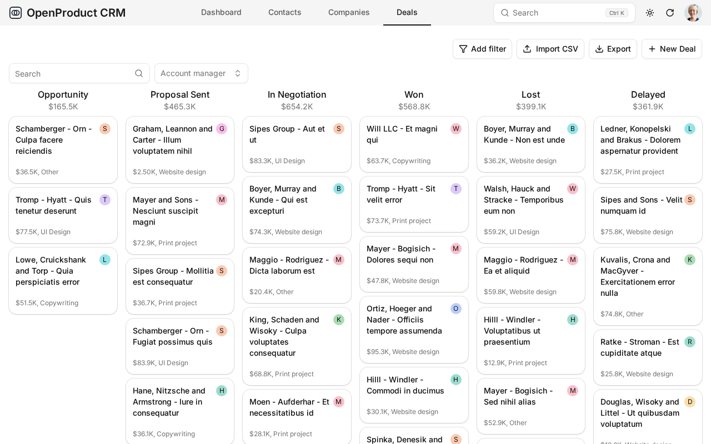

# OpenProduct CRM

An open-source, multi-tenant CRM that runs on Cloudflare's edge. Track
contacts, companies and deals on a kanban board; keep notes, tasks and tags;
search everything; import and export CSV. It is built for many
organizations at once: each one's data is kept apart, teams sign in with
their own accounts, and AI agents will work with the CRM through an MCP
server.

**[Try the demo →](https://openproduct-crm-crm-web-prod.vijayakrishnan12994.workers.dev)**
The demo runs entirely in your browser on fake data; nothing you type leaves
the page.



## Why it exists

Most open CRMs assume one company per install and a server you run yourself.
OpenProduct CRM is built as a service from day one: one deployment serves many
organizations, each with its own members, roles, invitations, API keys,
webhooks, audit log and billing. It runs on Cloudflare Workers with Postgres
(Supabase, through Hyperdrive), so there is no server to patch.

## Status

The demo web app is live. The CRM's own API, storage and sign-in are being
built in milestones: see the
[plan](specs/epics/openproduct-crm-port/implementation-plan.md) and the
[progress ledger](ai/context/crm-port-ledger.md).

## Self-hosting

You need a Cloudflare account, a Supabase organization and an
[Orun](https://github.com/sourceplane/orun) workspace. Fork this repository,
point `intent.yaml` at your workspace and your workers.dev subdomain, connect
GitHub, Cloudflare and Supabase to the workspace, and merge to `main`: CI
provisions the databases and deploys stage, then prod. The full runbook is in
[ai/context/operations.md](ai/context/operations.md).

## Credits

- The web app is based on [Atomic CRM](https://github.com/marmelab/atomic-crm)
  by Marmelab (MIT). OpenProduct CRM is a separate product, not Atomic CRM
  and not a Marmelab product. See [THIRD_PARTY_NOTICES.md](THIRD_PARTY_NOTICES.md).
- The platform (identity, organizations, billing, webhooks and the rest) is
  built on the [Lumen baseline](https://github.com/sourceplane/lumen).

Licensed under the [MIT License](LICENSE). Security reports:
[SECURITY.md](SECURITY.md). Contributions: [CONTRIBUTING.md](CONTRIBUTING.md).

## Architecture

`vijayakrishnans/openproduct-crm` is an
[Orun](https://github.com/sourceplane/orun) component-native desired-state
repo. Identity, organizations, projects, RBAC, audit, metering, billing,
webhooks and notifications are separate bounded-context Workers behind one
public edge API, with a Next.js console and the CRM web app on Workers +
Static Assets.

## Live deployment

<!-- 08-docs:begin -->
This product is **live**. Verified URLs, identity, and the secrets
inventory are recorded in
[ai/context/deployment.md](ai/context/deployment.md) (regenerated by the
docs flow — command in the operating contract); how it deploys and how to
operate it: [ai/context/operations.md](ai/context/operations.md).
<!-- 08-docs:end -->

## Working on it

Start at [AGENTS.md](AGENTS.md). It is written for a coding agent and is the
shortest way in for a person too: what to read first, how a change lands, and
what not to touch.

## What is here

| Path | What it is |
|---|---|
| `apps/api-edge` | The one public HTTP entry point; reaches the workers over service bindings |
| `apps/*-worker` | Twelve bounded-context Workers — identity, membership, projects, policy, events, config, metering, billing, notifications, webhooks, integrations, admin. Never public |
| `apps/web-console-next` | The console: Next.js on Workers + Static Assets, configured against the edge |
| `apps/crm-web` | The CRM web app (Vite + React, from Atomic CRM) on Workers + Static Assets |
| `packages/*` | Shared libraries: contracts, SDK, CLI, the database harness, the policy engine, the notifications client, the webhook verifier |
| `infra/terraform/*` | The data plane: Supabase projects, Hyperdrive, the edge's idempotency KV, and the custom-domain component (parked until a domain is set) |
| `infra/db-migrate` | Database migrations — planned on pull requests, applied on merge |
| `tests/*` | Per-component contract and verifier suites |
| `intent.yaml` | The environments, the pinned composition catalog, and the Orun workspace this repository deploys into |

`stage` and `prod` are provisioned and deployed; `dev` is verify-only.

## Getting started

Node.js 20 or later and pnpm 10.

```bash
pnpm install
pnpm typecheck
pnpm lint
pnpm test
pnpm build
```

## How it deploys

Merges to `main` converge through Orun: `.github/workflows/ci.yml` runs
`orun plan --changed`, then one `orun run` lane per planned component. A pull
request plans and verifies; a push to `main` deploys `stage`, then `prod` once
`stage` has converged on the same commit. No pnpm, Wrangler or Terraform
command runs directly in CI.

The pipeline holds one credential, GitHub's own `GITHUB_TOKEN`. Cloudflare and
Supabase credentials are brokered per run from the workspace's connections;
nothing provider-shaped is stored in the repository or in GitHub.

## Custom domain

The product answers on workers.dev from its first deploy. Setting a domain is
one pull request, later:
[Setting the domain later](ai/context/operations.md#setting-the-domain-later).
