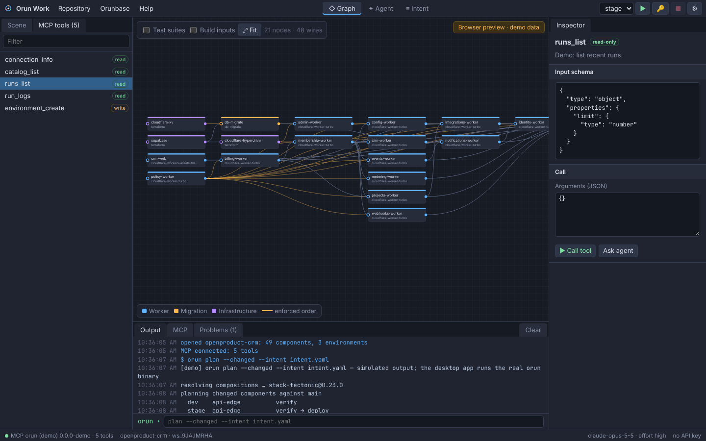
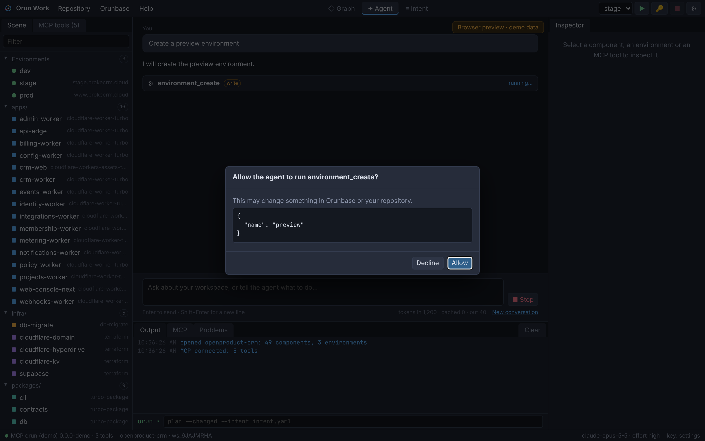

# Orun Work

A desktop editor and agent for [Orunbase](https://orunbase.com), in the
shape of a game-engine editor: the repository's components on a node graph,
docks around it, a console at the bottom, and an agent you can hand work to,
the way opencode works on code.

- **Scene dock** — `intent.yaml`'s environments and every `component.yaml`
  under its discovery roots, grouped by root.
- **Graph** — each component a node, each `dependsOn` a wire, laid out by
  dependency depth. Enforced deploy order is orange; build inputs and test
  suites can be shown. Drag to pan, wheel to zoom.
- **Inspector** — the selected component (type, path, environments,
  dependencies both ways, parameters, its YAML), environment (addresses,
  subscribed components, secret names) or MCP tool (schema, a form to call
  it).
- **Agent** — Claude (`claude-opus-5-5`) with the orun MCP server's tools and
  an `orun_cli` tool. Read-only tools run directly (configurable); anything
  that may change state shows an approval prompt first.
- **Bottom panel** — orun's output, an `orun ▸` console, the raw MCP traffic,
  and problems.
- **Run bar** — environment picker, ▶ `orun plan --changed`, secret names for
  the chosen environment, stop.

## How it talks to Orunbase

Orun Work has no Orunbase client of its own. It starts its bundled `orun mcp serve` (the
local MCP server orun ships, newline-delimited JSON-RPC over stdio) in the
open repository and runs `orun` commands there, so it acts as whoever is
signed in with `orun auth login`, with that login's permissions. Turn on
*Start the MCP server read-only* in Settings to drop the platform's write
tools entirely.

The agent's model calls go straight from your machine to the Anthropic API
with your key (Settings, or `ANTHROPIC_API_KEY` in the environment the app
starts in). The key stays in the app's local storage on your computer. The
agent enables server-side refusal fallbacks (`fallbacks: "default"`), so a
request Opus 5.5 declines is retried on a fallback model; the transcript
says when that happens.

## Requirements

Only the installer. It carries its own orun (v2.96.0, built for Windows by
`scripts/build-orun.sh`, since orun publishes macOS and Linux binaries
only), and the first-run screen signs you in to Orunbase from inside the
app. WebView2 ships with Windows 10 and 11; if it is missing, the installer
fetches it.

The one thing the app cannot carry is a key for the agent: it runs on
Claude with your own Anthropic API key, pasted on the first-run screen or in
Settings. Everything else works without one.

## Develop

```bash
npm install
scripts/build-orun.sh "$(rustc -vV | sed -n 's/host: //p')"   # the bundled orun, for tauri dev
npm run dev          # the editor in a browser, with demo data (no orun needed)
npm run tauri dev    # the real desktop app
npm test
```

`npm run dev` without Tauri serves a snapshot of a real orun repository and
a simulated MCP server and CLI, all labelled as demo. Refresh the snapshot
with `node scripts/snapshot-demo.mjs <path-to-an-orun-repo>`.

## Release

Push a tag `orun-work-v<version>` (matching `version` in
`src-tauri/tauri.conf.json`), or run the *orun-work release* workflow by
hand. It builds orun for Windows, then the NSIS `.exe` and the `.msi` on a
Windows runner, and attaches them to a draft GitHub release. From Linux:
`scripts/build-orun.sh x86_64-pc-windows-gnu && npx tauri build --target
x86_64-pc-windows-gnu --bundles nsis` (needs `nsis` and `mingw-w64`).

## Permissions

`src-tauri/capabilities/default.json` is the whole list: start one program,
the bundled `orun`, with any arguments; read files and folders (never write); a folder
picker; HTTPS to `api.anthropic.com`; open links in the browser.

## Screenshots



