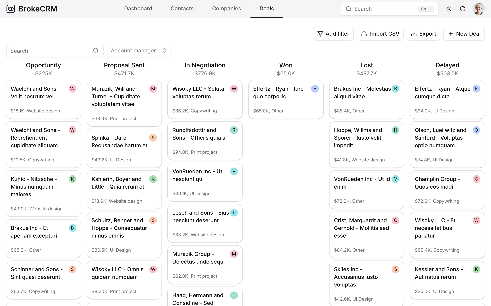
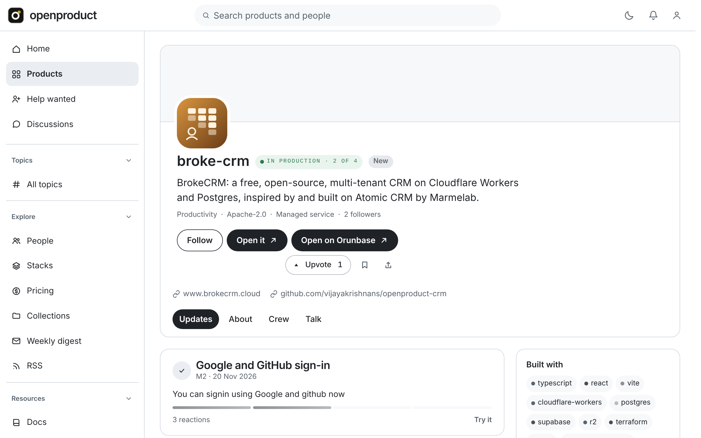

<!--
TITLE OPTIONS (pick one)
1. I Got a Breach Email on a Saturday. I Had Nothing to Rotate.
2. My CRM's Source Code Is Public. Its Keys Expire in 15 Minutes.
3. "Rotate Your Keys Today." What If You Didn't Have Any?

SUBTITLE
An OpenRouter provider got breached. Here's why my CRM, deployed from a public repo, didn't care.

IMAGES: the deals board and the OpenProduct page are in docs/blog/images/.
The Orunbase workspace screenshot still has to be uploaded by hand where the
post marks its place; the line under it is the caption.

TAGS: Security, DevOps, Open Source, Cloudflare, SaaS
-->

# I Got a Breach Email on a Saturday. I Had Nothing to Rotate.

An OpenRouter provider got breached, and here's why my CRM, deployed from a public repo, didn't care.

---

The subject line was quiet, the way they always are, because nobody titles these "lol, bad news".

> **Requests you sent through GMI Cloud may have been read**

OpenRouter was letting me know that GMI Cloud, one of the providers it routes model requests to, had been breached by an attacker who got into a system that kept about three days of request content and, in OpenRouter's words, searched it for credentials in prompts.

Then came the line that made me put my coffee down:

> Your account sent 942 requests to GMI Cloud between October 20 and November 13.

That's 942 requests across a month of coding sessions, pasted logs and pasted configs, and I could not tell you what was in a single one of them.

It wasn't theoretical either, because a security researcher had planted AWS test keys in prompts sent to GMI Cloud, and those keys were later used to try to create new IAM users.

The advice at the bottom was the advice we all know by heart:

> Rotate any keys, passwords, tokens or signed URLs that appeared in them, starting with the most privileged.

## "Rotate your keys" assumes you know which keys

Nobody remembers every `.env` they pasted into a chat at 1 a.m., or every curl command with a bearer token they asked an AI to fix, because the 1 a.m. version of any of us is less a security professional than a raccoon with a keyboard.

So rotation turns into archaeology, where you go through every dashboard, regenerate everything, redeploy, and hope you didn't miss the one in the cron job you wrote two years ago and have been afraid to touch ever since.

I started that drill for BrokeCRM, the product I've been building, and found something that felt almost unfair.

**There was nothing to rotate.**

That's not because I'm careful (please see the raccoon) but because the keys my system uses don't live long enough to be worth stealing.

## A CRM where everything about it is public

> [BrokeCRM](https://www.brokecrm.cloud) is a free CRM with contacts, companies, deals on a kanban board, notes, tasks, tags, search, and CSV import and export, plus an MCP server so your AI agent can work with your CRM through typed tools instead of free-form SQL.

Yes, it is called BrokeCRM, and since it is free the name is not exactly subtle.


The deals board in the BrokeCRM demo, which runs in your browser on made-up data.

It's built on the open-source [Atomic CRM](https://github.com/marmelab/atomic-crm), reworked so that one deployment serves many organizations with each one's data kept apart, and it runs on Cloudflare Workers with Postgres on Supabase.

**The whole repo is public** at [github.com/vijayakrishnans/openproduct-crm](https://github.com/vijayakrishnans/openproduct-crm), so every line of infrastructure and every deploy pipeline is readable by anyone.

That includes the Terraform that creates the Supabase projects, the Cloudflare domain, Hyperdrive and KV, along with the database migrations, the Workers, the web app and the CI pipeline that ties them together.

Every part of the multi-tenant CRM lives in that one repo, so if you fork it and connect your own Cloudflare and Supabase in your Orunbase workspace, you have the whole platform.

It goes further than the code, because BrokeCRM is an **OpenProduct**, which means the repo and the workspace that builds and deploys it are both public.


BrokeCRM's page on OpenProduct, with the link through to its Orunbase workspace.

Anyone can open [openproduct.live/broke-crm/workspace](https://openproduct.live/broke-crm/workspace) and see what I see, from the stage and prod URLs to every run, the PRs that went out and the work still in progress, and since my failed deploys are on there too it is a humbling way to build software.

[ Upload the Orunbase workspace screenshot here ]
The live BrokeCRM workspace, open to anyone, showing 107 runs in the last 7 days, 14 of them failed and 63 PRs merged, without a single key anywhere on it.

People ask if that's reckless, but I think it's safer than most private repos I've worked in.

A private repo is where people get comfortable, where `config.prod.json` gets committed "just for now" and a do-everything `CLOUDFLARE_API_TOKEN` sits in CI secrets for three years like leftovers nobody will claim.

A public repo and a public workspace force you to assume everything is read by everyone, forever, so you design for it.

## Orun and Orunbase: where the secrets actually live

The repo is an **Orunbase workspace** project, and that's what makes this work.

[Orun](https://github.com/sourceplane/orun) is an open-source CLI that reads a repo's `intent.yaml`, works out which components changed, and plans and runs the jobs to deploy them.

**Orunbase** is the hosted side, which holds the workspace's secrets and its connections to Cloudflare and Supabase and decides which CI run is allowed to touch what.

In practice I connected GitHub, Cloudflare and Supabase to the workspace once, and since then every merge to `main` has deployed stage, then prod, without me ever copying a key into GitHub settings.

Here's how that holds up when the source is public.

### 1. CI proves who it is, with no stored password

The workflow asks GitHub for one permission that matters:

```yaml
permissions:
  contents: read
  id-token: write
```

That lets the job get an **OIDC token** from GitHub, a short-lived, signed note that says "this is a workflow run in this repo, right now", which Orun swaps with Orunbase, which:

- checks GitHub's signature and which repo is asking,
- checks that repo against the workspace's allow-list,
- and only then issues a token bound to one workspace and one project.

The workspace is declared in the committed `intent.yaml` (`workspace: ws_9JAJMRHA`, `requireOrg: true`), so a run can't land in the wrong place by forgetting a flag.

A repo that isn't on the allow-list gets a `404`, not a `403`, a bit like a bouncer who doesn't say you're not on the list but insists there is no club.

If you fork my repo, your fork's token says your repo, and my workspace has never heard of it.

### 2. The repo holds addresses, not secrets

Component files contain lines like this:

```yaml
GITHUB_OAUTH_CLIENT_SECRET: "secret://ws_9JAJMRHA/openproduct-crm/{{ .environment }}/GITHUB_OAUTH_CLIENT_SECRET"
```

That's an address, not a value, and knowing my address does not get you into my house.

The value lives encrypted in Orunbase, where it is only resolved while a job is actually running, checked against what that job is allowed to read, tied to the job's live lease so a finished runner can't come back for it later, and redacted from logs before they're written.

### 3. Cloudflare and Supabase keys are minted per run

This is the part that turned the breach email into a non-event.

My pipeline never holds a standing Cloudflare or Supabase key, so when a deploy job needs one, Orunbase mints a fresh one for that run:

- **Cloudflare:** a scoped child token that expires after **15 minutes** by default, never more than an hour.
- **Supabase:** a short-lived Management API token, capped at one hour.

Each mint is scoped down, logged and expires on its own.

So take the worst case, where I paste a deploy log into a chat, it passes through a breached provider, and an attacker scrapes the Cloudflare token out of it.

By the time they find it, it has already expired, which makes them the proud owner of last week's lottery ticket.

**Rotation shouldn't be an emergency you run after a breach, it should just be how the system works.**

If every key is replaced every time the pipeline runs, a leaked key is just a very boring string.

## The honest part

Something long-lived has to exist, or nothing could mint anything, and here that's the parent grant, the credential Orunbase uses to create the short-lived tokens, which is stored encrypted inside Orunbase only and not in the repo, CI or the app.

A couple of values, like the database password, are long-lived by nature, so they're stored encrypted, given only to jobs that need them, and never printed.

So it's not "nothing long-lived anywhere" but a short list of long-lived things, all in one place I can point to, and none of them in the public repo or the public workspace.

## If you take one thing from this

The next breach email is coming, probably on another Saturday, so before it does:

1. **Get static secrets out of CI**, since GitHub Actions supports OIDC, and AWS, GCP, Azure and Cloudflare can all trust it.
2. **Make every credential expire**, because minutes beat days and days beat never.
3. **Commit references, not values**, so that if your repo went public tomorrow, nothing would need rotating.

BrokeCRM is free to use at [brokecrm.cloud](https://www.brokecrm.cloud), the [repo](https://github.com/vijayakrishnans/openproduct-crm) is open if you want to fork it, and the [workspace](https://openproduct.live/broke-crm/workspace) is open if you just want to watch it ship.

Your fork comes with the whole platform and no secrets to steal, because mine never had any.

I hope that when your breach email arrives, you have nothing to rotate and you get to finish your coffee.

---

Found a security issue in BrokeCRM? Please report it privately through GitHub's "Report a vulnerability" on the repo.
